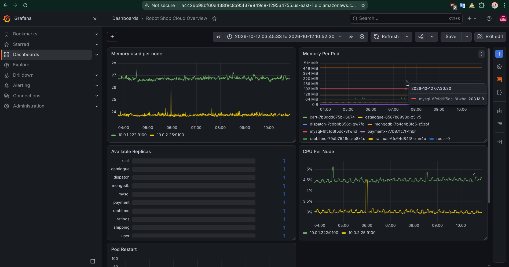

# 04 - Cloud Observability

Adds Prometheus and Grafana to the EKS cluster, so I can see the health of Robot Shop and the nodes it runs on.

## What it does

- **Prometheus** collects numbers from the cluster every ~30 seconds
- **Grafana** draws those numbers as graphs
- Both come from one Helm chart: `kube-prometheus-stack`

## Files

| File | Purpose |
|------|---------|
| `prom-values.yaml` | Settings for the install (storage, resources, public address for Grafana) |
| `dashboards/robot-shop-cloud-overview.json` | The dashboard, saved as a file so it can be loaded again |
| `screenshots/` | Proof that it works |

## Steps

```bash
kubectl create namespace monitoring
helm repo add prometheus-community https://prometheus-community.github.io/helm-charts
helm repo update
helm install kube-prom-stack prometheus-community/kube-prometheus-stack \
  --namespace monitoring -f prom-values.yaml

# public address for Grafana
kubectl -n monitoring get svc kube-prom-stack-grafana

# login: user is admin, password comes from this command
kubectl -n monitoring get secret kube-prom-stack-grafana \
  -o jsonpath="{.data.admin-password}" | base64 -d; echo
```

To load the dashboard: in Grafana, go to Dashboards, then New, then Import, and upload the JSON file.

## Dashboard: Robot Shop Cloud Overview (5 panels)

| Panel | What it shows | Query |
|-------|---------------|-------|
| Memory used per node | How full each server's memory is (%) | `(1 - node_memory_MemAvailable_bytes / node_memory_MemTotal_bytes) * 100` |
| CPU per node | How busy each server is (%) | `100 - (avg by (instance) (rate(node_cpu_seconds_total{mode="idle"}[5m])) * 100)` |
| Memory per pod | Memory used by each Robot Shop pod | `sum by (pod) (container_memory_working_set_bytes{namespace="robot-shop", container!=""})` |
| Available replicas | How many copies of each service are running | `kube_deployment_status_replicas_available{namespace="robot-shop"}` |
| Pod restarts | How many times each pod restarted | `sum by (pod) (kube_pod_container_status_restarts_total{namespace="robot-shop"})` |

Two panels show the servers (cloud side) and three show the app.



## Settings that matter on EKS

- **Control plane scraping is off.** AWS runs the control plane, so Prometheus cannot reach it. Leaving it on only creates empty targets.
- **Storage is set by hand.** The chart does not create disks unless it is told which StorageClass to use. Here it uses `standard`.

## Notes

- The replicas panel shows 11 services, not 12. Redis runs as a StatefulSet, and that query only counts Deployments.
- The dashboard lives on a disk that is deleted with the cluster. The JSON file in this repo is the backup.

## Known simplification

Grafana is open to the internet through a load balancer and uses the default `admin` user. Fine for a short demo. A real setup would restrict access and use proper login.

## Tear down

Do these before `terraform destroy`:

```bash
helm uninstall kube-prom-stack -n monitoring
kubectl -n monitoring delete pvc --all
```

The load balancer and disks are created by Kubernetes, not Terraform. If they are left behind, they keep costing money and can block the VPC from deleting.
