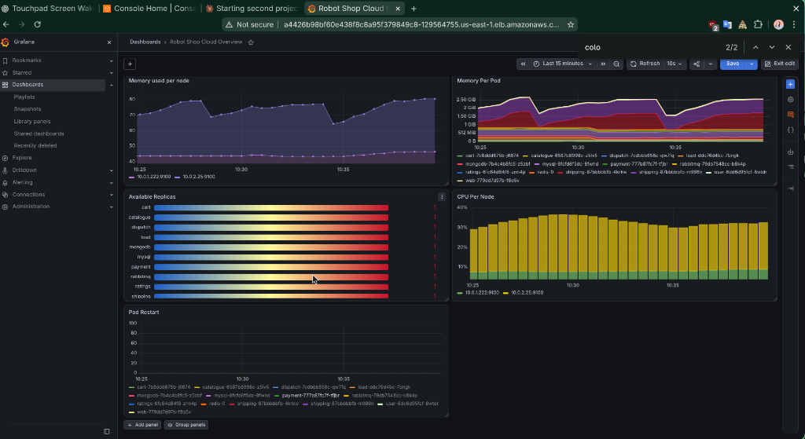
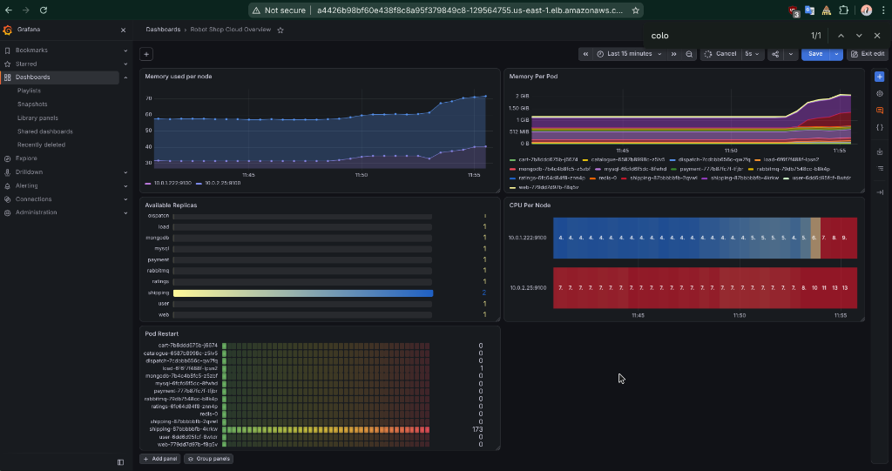
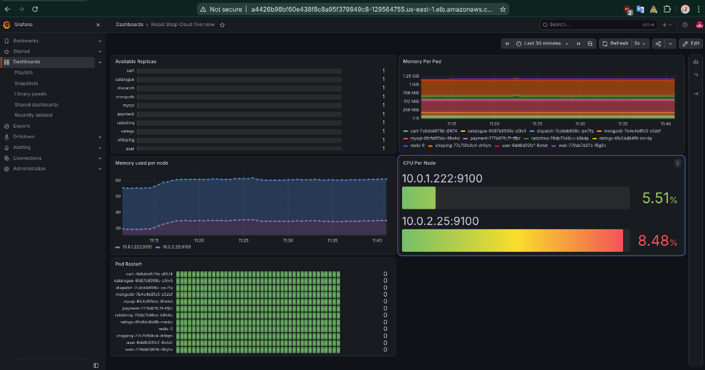

# 05 - Autoscaling Demo

Shows Kubernetes adding a pod by itself when a service gets busy.

## How it works

- An autoscaler (HPA, Horizontal Pod Autoscaler) watches the CPU of 8 Robot Shop services (the app services, not the databases or the message queue)
- Target: 50% of the CPU each pod asked for (100m, so 50m)
- Above that, Kubernetes adds a pod. Minimum 1, maximum 2
- CPU numbers come from metrics-server (installed in Module 2)
- A load generator sends fake shoppers into the cluster to push CPU up

## Files

| File | Purpose |
|------|---------|
| `autoscale.sh` | Creates the 8 autoscalers (from Robot Shop, one flag changed) |
| `load-deployment.yaml` | Load generator, 15 simulated shoppers (Robot Shop default) |
| `hpa-idle-state.txt` | Autoscaler status when quiet |
| `screenshots/` | Grafana before, during and after |

## Steps

```bash
sh autoscale.sh
kubectl -n robot-shop get hpa
kubectl -n robot-shop apply -f load-deployment.yaml
kubectl -n robot-shop get hpa -w      # watch it react

# stop the load
kubectl -n robot-shop delete -f load-deployment.yaml
```

## Result

- **Before:** every service at 1 pod
- **During:** shipping went from 1 to 2 pods. The other services stayed at 1.
- **After:** load removed, every service back at 1 pod. Kubernetes waits about 5 minutes before removing pods.





## Problem and fix

| Problem | Cause | Fix |
|---------|-------|-----|
| `autoscale.sh` failed: "flag --cpu-percent has been deprecated" | Newer kubectl dropped the old flag | Changed it to `--cpu 50%` |

## Notes

- Maximum is 2 pods, set in the script
- The load generator is for short demos, not long runs

## Tear down

```bash
kubectl -n robot-shop delete -f load-deployment.yaml
kubectl -n robot-shop delete hpa --all
```
