# Cloud-Native Robot Shop on AWS

[](https://github.com/almecc/cloud-native-robotshop-aws/actions/workflows/terraform-ci.yml)

End-to-end deployment of [Robot Shop](https://github.com/instana/robot-shop) (a 12-microservice demo app) on AWS EKS, with infrastructure as code, CI/CD, monitoring, and autoscaling.

## Architecture

```mermaid
graph TB
    %% ── External actors ──
    USER(["🌐 Users"])
    DEV(["👨‍💻 Developer"])

    %% ── GitHub CI/CD ──
    subgraph GITHUB["☁️ GitHub"]
        direction LR
        REPO["📦 Repository"]
        GHA["⚙️ Actions Pipeline<br/><i>fmt → validate → plan → deploy</i>"]
        REPO --> GHA
    end

    subgraph AWS["Amazon Web Services — us-east-1"]

        %% ── Supporting Services ──
        subgraph SUPPORT[" "]
            direction LR
            S3["🪣 S3<br/><i>Terraform State</i>"]
            IAM["🔐 IAM + OIDC<br/><i>Federated Auth</i>"]
        end

        %% ── VPC ──
        subgraph VPC["🔒 VPC — 10.0.0.0/16"]
            IGW["🌐 Internet Gateway"]

            subgraph SUBNETS[" "]
                direction LR
                SUB1["📡 Public Subnet<br/>10.0.1.0/24<br/><i>us-east-1a</i>"]
                SUB2["📡 Public Subnet<br/>10.0.2.0/24<br/><i>us-east-1b</i>"]
            end

            subgraph EKS["⎈ EKS — robotshop-cluster — K8s 1.35"]
                direction TB

                subgraph NODES["🖥️ Node Group: 2 × m7i-flex.large (max 3)"]
                    direction LR

                    subgraph NS_RS["namespace: robot-shop"]
                        direction TB
                        WEB["🌐 web"]
                        CART["🛒 cart"]
                        CATALOGUE["📚 catalogue"]
                        USER_SVC["👤 user"]
                        PAYMENT["💳 payment"]
                        SHIPPING["📦 shipping"]
                        RATINGS["⭐ ratings"]
                        DISPATCH["📨 dispatch"]
                        MONGO["🍃 mongodb"]
                        MYSQL["🐬 mysql"]
                        RABBIT["🐰 rabbitmq"]
                        REDIS["🔴 redis<br/><i>StatefulSet + PVC</i>"]
                        LOAD["🔥 load generator<br/><i>rs-load</i>"]
                        HPA["📈 HPA<br/><i>8 services × 50% CPU</i>"]
                    end

                    subgraph NS_MON["namespace: monitoring"]
                        direction TB
                        PROM["📊 Prometheus<br/><i>kube-prometheus-stack</i>"]
                        GRAFANA["📉 Grafana<br/><i>Custom Dashboards</i>"]
                        EXPORTER["📡 node-exporter"]
                        KSM["📋 kube-state-metrics"]
                    end

                    subgraph NS_SYS["namespace: kube-system"]
                        direction TB
                        METRICS["📏 metrics-server"]
                        EBS["💾 EBS CSI Driver<br/><i>IRSA</i>"]
                    end
                end
            end
        end
    end

    %% ── Connections ──
    DEV -- "git push" --> REPO
    GHA -- "OIDC federation" --> IAM
    GHA -- "helm upgrade" --> EKS
    GHA -- "terraform plan" --> S3
    USER -- "HTTP :8080" --> IGW
    IGW --> WEB
    PROM -- "scrape metrics" --> NS_RS
    METRICS -. "CPU/mem data" .-> HPA
    HPA -. "scale pods" .-> SHIPPING
    LOAD -- "synthetic traffic" --> WEB

    %% ── Styles ──
    classDef awsBox fill:#232F3E,stroke:#FF9900,stroke-width:2px,color:#FFFFFF
    classDef vpcBox fill:#1A3A5C,stroke:#3B82F6,stroke-width:2px,color:#FFFFFF
    classDef eksBox fill:#1E3A5F,stroke:#326CE5,stroke-width:2px,color:#FFFFFF
    classDef nodeBox fill:#0F2942,stroke:#60A5FA,stroke-width:1px,color:#FFFFFF
    classDef nsApp fill:#064E3B,stroke:#10B981,stroke-width:1px,color:#FFFFFF
    classDef nsMon fill:#4C1D95,stroke:#8B5CF6,stroke-width:1px,color:#FFFFFF
    classDef nsSys fill:#78350F,stroke:#F59E0B,stroke-width:1px,color:#FFFFFF
    classDef ghBox fill:#0D1117,stroke:#58A6FF,stroke-width:2px,color:#FFFFFF
    classDef supportBox fill:#1C2833,stroke:#FF9900,stroke-width:1px,color:#FFFFFF
    classDef actor fill:#2563EB,stroke:#1D4ED8,stroke-width:2px,color:#FFFFFF,border-radius:50%

    class AWS awsBox
    class VPC vpcBox
    class EKS eksBox
    class NODES nodeBox
    class NS_RS nsApp
    class NS_MON nsMon
    class NS_SYS nsSys
    class GITHUB ghBox
    class SUPPORT supportBox
    class USER,DEV actor
```



## Modules

| # | Module | What it does |
|---|--------|-------------|
| 01 | [Terraform Foundation](01-terraform-foundation/) | VPC, subnets, EKS cluster, node group, IAM roles, EBS CSI driver |
| 02 | [Robot Shop on EKS](02-robotshop-on-eks/) | Deploys 12 microservices via Helm, storage class, metrics server |
| 03 | [CI/CD Pipeline](03-cicd-pipeline/) | GitHub Actions with OIDC login — format, validate, plan, deploy |
| 04 | [Cloud Observability](04-cloud-observability/) | Prometheus + Grafana via kube-prometheus-stack, custom dashboards |
| 05 | [Autoscaling Demo](05-autoscaling-demo/) | HPA on 8 services, load generator, scale-up proof |

All modules complete.

## Tech Stack

| Layer | Tool |
|-------|------|
| Infrastructure | Terraform, AWS (VPC, EKS, IAM, EBS) |
| Container Orchestration | Kubernetes 1.35 (EKS) |
| Application | Robot Shop (12 microservices) |
| Package Management | Helm |
| CI/CD | GitHub Actions, OIDC federation |
| Monitoring | Prometheus, Grafana |
| Autoscaling | Kubernetes HPA, Metrics Server |

## Quick Start

On a fresh cluster:

```bash
# 1. Provision infrastructure (the first apply stops at the EKS access entries - expected)
cd 01-terraform-foundation
terraform init && terraform apply

# 2. Bootstrap the cluster (auth mode, kubeconfig, metrics-server, namespace),
#    then run "terraform apply" in 01-terraform-foundation once more
cd ..
./bootstrap.sh

# 3. Deploy Robot Shop
helm install robot-shop 03-cicd-pipeline/robot-shop-chart --namespace robot-shop

# 4. (Optional) Install monitoring
cd 04-cloud-observability
kubectl create namespace monitoring
helm install kube-prom-stack prometheus-community/kube-prometheus-stack \
  --namespace monitoring -f prom-values.yaml

# 5. (Optional) Enable autoscaling
cd ../05-autoscaling-demo
sh autoscale.sh
```

## Tear Down

**Do these before `terraform destroy`** — Kubernetes-created resources (load balancers, EBS volumes) are not tracked by Terraform and will keep costing money if left behind.

```bash
# Delete load generator and HPAs (if running)
kubectl delete -f 05-autoscaling-demo/load-deployment.yaml -n robot-shop 2>/dev/null
kubectl -n robot-shop delete hpa --all 2>/dev/null

# Uninstall monitoring
helm uninstall kube-prom-stack -n monitoring
kubectl -n monitoring delete pvc --all

# Uninstall Robot Shop
helm uninstall robot-shop -n robot-shop
kubectl -n robot-shop delete pvc --all

# Verify nothing is left
kubectl get svc,pvc -A | grep -v kubernetes

# Destroy infrastructure
cd 01-terraform-foundation
terraform destroy

# Check AWS directly for leftovers (both should print nothing)
aws elb describe-load-balancers --region us-east-1 --query "LoadBalancerDescriptions[].LoadBalancerName" --output text
aws ec2 describe-volumes --region us-east-1 --query "Volumes[].VolumeId" --output text
```
